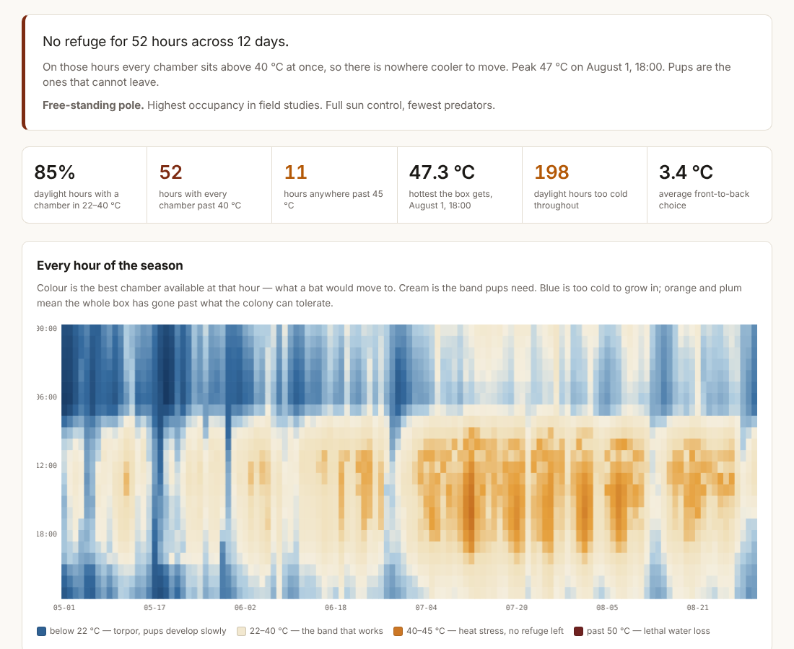

# Roostcast

A browser tool that simulates the temperature inside a bat house, hour by hour and chamber by chamber, through a real summer at your coordinates. It tells you whether the box you are about to hang will cook the colony that moves into it. With no fitted constants, it lands within 1.6 °C of a roost measured in the 2021 heat dome. It is plain JavaScript in one HTML file, with hourly ERA5 weather from Open-Meteo.

**Status: working.** Absolute temperatures carry about ±5 °C, and the model has been tested against published summaries only, not yet against loggers of its own.

Live: https://ampactor.dev/roostcast/



## Quick start

Open https://ampactor.dev/roostcast/, or `dist/roostcast.html` straight from disk.
Nothing to install; no account; works from a USB stick. Type a place, describe
the box, press run. The first result arrives in a few seconds; the sweep of
every colour, mount and orientation follows it.

## Usage

### Link to one box

Query parameters set the form, so a proposal, an email or a QR code on a bat
house can open the page on one exact box. Anything missing or not on the menus
keeps its default. `run=1` starts the simulation on load.

| Parameter | Values |
|---|---|
| `lat`, `lon` | decimal degrees |
| `place` | label for the search box |
| `design` | `single`, `three`, `four`, `rocket` |
| `color` | `black`, `dark`, `medium`, `light`, `white` |
| `mount` | `pole`, `building`, `tree` |
| `facing` | degrees: `0`, `45`, ... `315` |
| `exposure` | `full`, `morning`, `afternoon`, `partial`, `dappled`, `shade` |
| `height` | metres, 1 to 12 |
| `year` | a season on the menu, or `hottest` |

The Jordan River in Salt Lake City, summer 2026, with the box from the
Cuddlecast proposal:
<https://ampactor.dev/roostcast/?lat=40.735&lon=-111.96&place=Jordan+River,+Salt+Lake+City&color=medium&mount=pole&facing=135&year=2026&run=1>

### Command line

```
node tools/validate.js         # test against published measurements
node tools/report.js           # colour table vs simulation, nine sites
node tools/report.js --hottest # same, worst season of the last ten
node tools/smoke.js            # drive the real page in headless Chrome
node tools/build.js            # inline everything into dist/roostcast.html
```

Weather is cached under `.cache/`, so everything after the first run is offline.

## How it works

### Why this exists

Bat house guidance decides paint colour from one number, the average July daily
high:

| Average July high | Paint it |
|---|---|
| under 85 °F | black |
| 85–95 °F | dark brown or dark grey |
| 95–100 °F | medium |
| over 100 °F | white or light |

That rule is careful work and it is the best thing anyone had for thirty years.
It is also an average, and bats do not die on averages.

Portland, Oregon has an average July high of 82 °F, which puts it in the coldest
bucket: paint it black. In June 2021 the heat dome sat on Portland for four days.
Run a black four-chamber box through that season and the model gives a peak of
47 °C and fourteen hours where no chamber in the box is under 40 °C. A roosting
bat cannot leave in daylight. Painted white, the same box at the same site peaks
at 45.8 °C and spends five fewer hours past 45 °C.

Lillooet, British Columbia is worse. Average July high 85 °F, so again the table
says black. Black gives 17 hours with no cool chamber anywhere; white gives 8,
and cuts time past 45 °C by fourteen hours. Lillooet is where de Mel and
colleagues measured a real east-facing roost hitting 55.5 °C for six hours in
that same heat dome, and calculated that the bats inside would have needed to
evaporate more than 22% of their body mass to survive it.

The table cannot see any of this. It knows one number about a place. It does not
know your latitude, which way the box points, whether its back is against a wall,
or that the sun striking a south-facing wall in late August comes in at an angle
it never reaches in June.

So: stop looking the answer up, and simulate it.

### What it reports

Enter a location. It pulls hourly ERA5 reanalysis for that spot, picks the
hottest of the last ten maternity seasons if you want the worst case, and
runs a transient thermal model of the box you describe: how many chambers, what
colour, mounted on what, facing which way, in how much sun.

Out the other end:

**Refuge hours.** The share of daylight hours where at least one chamber sits in
22–40 °C. This is the floor. Below it, some part of the colony is in trouble.

**No-refuge hours.** Hours where every chamber is over 40 °C at once. This is the
number that matters most and the one no existing guidance produces. A box with
one scorching chamber and one cool one is a working box; a colony spreads out and
moves. A box where the whole thing is past 40 °C is a trap, because bats roost by
day and cannot fly out of it.

**Usable share.** What fraction of all chamber-hours are inside the band. Refuge
hours saturate near 100% on any multi-chamber box, so they cannot rank options;
this can.

Then it sweeps every combination of colour, orientation and mount against the
same season and ranks them, and tells you where the colour table and the
simulation disagree about your site.

### The model

`src/thermal.js` carries two nodes per wood panel, one per face, because a
19 mm board in full sun is meaningfully hotter on the sunlit side than on the
side the bats touch. Chamber air is solved algebraically each step from the
surfaces around it, as a chimney with a buoyant draught. What it reports is
operative temperature: the wood and the draught weighted by how strongly each
reaches a roosting bat. The integration is explicit, and each hour takes as
many substeps as that hour's wind needs to stay stable. The four large errors
made on the way, and what each cost, are in
[docs/model-errors.md](docs/model-errors.md).

## Data

Hourly ERA5 and ERA5-Land reanalysis from the Open-Meteo historical weather
API: free for non-commercial use, no key, hourly from 1940, on a grid of
roughly 9 km. The page caches it in `localStorage`; the tools cache it under
`.cache/`. Every threshold, constant and published number is in
[REFERENCES.md](REFERENCES.md).

## Project layout

```
index.html          the page
src/solar.js        sun position, irradiance on a tilted plane
src/thermal.js      the box: panels, chambers, chimney flow, scoring
src/presets.js      designs, colours, thresholds, the colour table
src/climate.js      ERA5 via Open-Meteo, cached in localStorage
src/ui.js           front end
tools/              validate, report, smoke, build
```

## Deploy

GitHub Pages, from `.github/workflows/deploy.yml`, on every push to `main`.
The job rebuilds `dist/roostcast.html`, fails if the committed copy is stale,
and publishes it as the site's `index.html`. Pull requests run the same build
without deploying.

## Testing

```
$ node tools/validate.js

published comparison                              want    model   err     ok
de Mel 2025 · east-facing roost, 2021 heat dome   55.5    53.9    -1.6    yes
Fontaine 2021 · share of season within 22-40 C    46.0    36.7    -9.3    yes
Fontaine 2021 · under pooled 7-site maximum       -5.0    -6.6    -1.6    yes

ordering the tool asserts
black peaks above white                           37.4 vs 31.6          yes
full sun peaks above full shade                   37.4 vs 31.6          yes
east wall-mount peaks earlier than west           11.3h vs 15.8h        yes
orientation barely matters on a free pole         37.7 vs 37.6          yes
tree mount runs cooler than open pole             33.8 vs 37.4          yes
front chamber hottest on a July afternoon         31.1 > 27.7 > 27.2    yes
south wall at 45 N peaks after midsummer          peak in month 9       yes
```

The heat-dome peak lands within 1.6 °C of a measured roost with no fitting, which
is better than I expected. The seasonal share is 9 points low, which I have not
resolved and am not going to paper over.

Two of the ordering results are worth pointing at, because the model produced
them before I knew to look for them. Fontaine reports that orientation makes
almost no difference to a pole-mounted box, and the model agrees, for a reason
that is obvious once you see it: a free-standing box has two exposed faces, so an
east-facing box is a west-facing box with its chambers in reverse order. Only a
wall at its back makes which way it points mean anything. And a south-facing
vertical wall at 45° N takes its hardest sun in September, not at the solstice,
because midsummer sun is too high to strike it squarely.

Why the seasonal share and the pooled maximum are compared the way they are is
in [docs/validation.md](docs/validation.md). CI runs the build and the
staleness check only. `validate.js` and `smoke.js` need live weather and are
run by hand.

## Limitations

Absolute temperatures carry roughly ±5 °C of uncertainty. Most of that is local
shading and wind that a 9 km reanalysis grid cannot see; some of it is that I
have no datalogger data of my own to test against, only what other people
published in summary form.

The comparisons are much firmer than the absolute numbers, because a modelling
error moves every option in the same direction. Use it to choose between
configurations, then verify the one you install.

It also does not know about occupancy. The model will happily rank a wall mount
above a pole on thermal grounds, and Tuttle's field data says pole-mounted houses
are occupied far more often and about two and a half times faster, with
tree-mounted houses worst of all for reasons that have nothing to do with
temperature: shade, predator access, branches in the flight path. The interface
prints that alongside the thermal result. A thermally perfect box on a tree trunk
is still a bad bat house.

Unmodelled, and all in the direction of the model running cool: bats packed into
a crevice obstruct the draught that cools it; the air in a tall crevice
stratifies rather than mixing; and I assume the crevice bottoms are fully open
across the box width.

## Roadmap

Field loggers. The Cuddlecast pilot on the Jordan River in Salt Lake City puts
temperature loggers in front and rear chambers of 30 to 40 boxes, so the model
can be scored on absolute temperature rather than on published summaries. It
is not done yet because no boxes are up yet.

## License

CC0. Public domain. Take it, fork it, put your own name on it, fold the model
into something better. If it helps one certification programme give
climate-aware advice instead of a lookup table, it has done its job.

Built for the people who have spent their lives arguing that bats are worth the
trouble.
